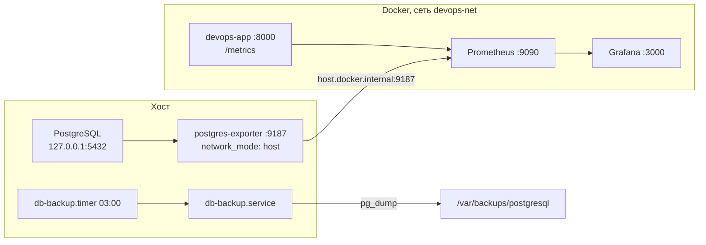
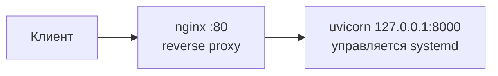

# DevOps Monitoring Platform


Учебный проект: полный цикл мониторинга приложения и базы данных — сбор метрик, хранение, визуализация, резервное копирование. Приложение поднимается двумя способами: через Docker Compose (быстрый старт) или как bare-metal сервис на Linux через systemd и nginx. PostgreSQL работает на хосте, бэкапится по расписанию и мониторится через `postgres_exporter`. Сборка и тесты проверяются в CI на каждый push.

Практика инструментов DevOps и администрирования: контейнеризация, мониторинг (Prometheus + Grafana), CI, bare-metal деплой (systemd, nginx, bash), PostgreSQL (роли, бэкапы, диагностика), конфигурация как код (provisioning Grafana, шаблон systemd-юнита).

## Содержание

- [Что внутри](#что-внутри)
- [Архитектура](#архитектура)
- [Стек](#стек)
- [Структура проекта](#структура-проекта)
- [Запуск: Docker](#запуск-docker)
- [Запуск: bare-metal](#запуск-bare-metal-systemd--nginx)
- [PostgreSQL](#postgresql-база-инвентаря-бэкапы-мониторинг)
- [Эндпоинты и метрики](#эндпоинты-и-метрики)
- [CI](#ci)
- [Траблшутинг](#траблшутинг-что-встретилось-на-практике)
- [Возможные доработки](#возможные-доработки)

## Что внутри

- **FastAPI-приложение** измеряет загрузку CPU и памяти хоста через `psutil` и отдаёт метрики в JSON и в формате Prometheus.
- **Prometheus** по расписанию опрашивает приложение и `postgres_exporter`, хранит метрики.
- **Grafana** с источником данных и дашбордами, подключёнными через provisioning: **System metrics** и **PostgreSQL** видны сразу после запуска.
- **PostgreSQL** на хосте: база инвентаря лабы, ежедневный бэкап по systemd timer с проверкой восстановления, отдельная роль с минимальными правами для мониторинга.
- **Bare-metal деплой**: systemd-сервис, nginx как reverse proxy, bash-скрипт автодеплоя с healthcheck.
- **Тесты** на `pytest`, линтер `flake8`, **CI** на GitHub Actions.

## Архитектура

**Docker-сценарий + PostgreSQL на хосте:**



Сервисы в сети `devops-net` обращаются друг к другу по имени контейнера. Prometheus сам забирает метрики (pull-модель). PostgreSQL слушает только `127.0.0.1`, поэтому экспортер запущен в сети хоста, а Prometheus достаёт его через `host.docker.internal`.

**Bare-metal сценарий:**



Приложение слушает только `127.0.0.1:8000` и снаружи недоступно напрямую. Эндпоинт `/metrics` в nginx закрыт `deny all`: снаружи 403, с самого сервера доступен.

## Стек

| Слой | Технологии |
|------|------------|
| Приложение | Python, FastAPI, psutil, prometheus-client |
| База данных | PostgreSQL, pg_dump / pg_restore |
| Мониторинг | Prometheus, Grafana, postgres_exporter |
| Контейнеризация | Docker, Docker Compose |
| Bare-metal | systemd (service + timer), nginx, bash, envsubst, ufw |
| Тесты и качество | pytest, flake8 |
| CI | GitHub Actions |

## Структура проекта

```
.
├── app/
│   ├── main.py                     # FastAPI-приложение, метрики CPU и RAM
│   └── requirements.txt
├── docker/
│   └── Dockerfile                  # образ приложения
├── compose/
│   ├── docker-compose.yml          # app + prometheus + grafana + postgres-exporter
│   └── .env                        # пароль экспортера (создаётся вручную, в .gitignore)
├── monitoring/
│   ├── prometheus.yml              # цели опроса: app, postgres
│   └── grafana/
│       ├── provisioning/
│       │   ├── datasources/        # Prometheus как источник данных
│       │   └── dashboards/         # провайдер дашбордов
│       └── dashboards/
│           ├── system.json         # System metrics
│           └── postgres.json       # PostgreSQL
├── deploy/                         # bare-metal деплой
│   ├── config.env                  # пользователь, путь и порт для конкретной машины
│   ├── app.service.template        # шаблон systemd-юнита (${APP_USER} и т.д.)
│   ├── install-service.sh          # установка systemd-сервиса (envsubst → unit)
│   ├── install-nginx.sh            # установка nginx reverse proxy
│   ├── deploy.sh                   # обновление: git pull + restart + healthcheck
│   ├── nginx/
│   │   └── app.conf                # конфиг reverse proxy
│   └── db/                         # PostgreSQL
│       ├── backup.sh               # pg_dump с ротацией (7 копий)
│       ├── restore-check.sh        # проверка восстановления последнего дампа
│       ├── db-backup.service       # что запускать: backup.sh от postgres
│       └── db-backup.timer         # когда: ежедневно в 03:00
├── tests/
│   └── test_app.py                 # тесты эндпоинтов
└── .github/workflows/ci.yml        # пайплайн CI
```

## Запуск: Docker

Нужен Docker с Docker Compose.

```bash
git clone https://github.com/Arteeemm/devops-monitoring-platform.git
cd devops-monitoring-platform/compose
docker compose up -d --build
```

| Сервис | Адрес | Назначение |
|--------|-------|------------|
| Приложение | http://localhost:8000/system | JSON с загрузкой CPU и памяти |
| Приложение | http://localhost:8000/metrics | метрики в формате Prometheus |
| Prometheus | http://localhost:9090 | хранилище метрик, Status → Targets |
| Grafana | http://localhost:3000 | дашборды (по умолчанию `admin` / `admin`) |
| postgres-exporter | http://localhost:9187/metrics | метрики PostgreSQL |

Графики заполняются через 1–2 минуты (интервал опроса Prometheus по умолчанию — 1 минута). Без PostgreSQL на хосте стек тоже работает, на дашборде PostgreSQL будет `DOWN`; настройка базы — в разделе [PostgreSQL](#postgresql-база-инвентаря-бэкапы-мониторинг).

## Запуск: bare-metal (systemd + nginx)

Приложение без Docker: systemd запускает uvicorn, nginx стоит перед ним.

**1. Окружение:**

```bash
git clone https://github.com/Arteeemm/devops-monitoring-platform.git
cd devops-monitoring-platform
sudo apt update && sudo apt install -y python3-venv gettext-base
python3 -m venv venv
venv/bin/pip install -r app/requirements.txt
```

**2. `deploy/config.env`** — единственное, что меняется при переезде на другой сервер:

```bash
APP_USER=<имя_пользователя>      # whoami
APP_DIR=/home/<имя_пользователя>/devops-monitoring-platform
APP_PORT=8000
```

**3. systemd-сервис:**

```bash
./deploy/install-service.sh
systemctl status app.service        # active (running), enabled
```

Скрипт подставляет значения из `config.env` в `app.service.template` через `envsubst`, кладёт юнит в `/etc/systemd/system/`, включает автозапуск и перезапускает сервис. Приложение работает от обычного пользователя, а не от root (принцип наименьших привилегий); `Restart=on-failure` поднимает его после падения.

**4. nginx:**

```bash
./deploy/install-nginx.sh
curl localhost/system
```

**5. Фаервол** — SSH разрешить до включения, иначе отрежешь себе доступ:

```bash
sudo ufw allow OpenSSH
sudo ufw allow 80/tcp
sudo ufw enable
```

**Обновление кода:**

```bash
bash deploy/deploy.sh
```

`deploy.sh` определяет текущую ветку, делает `git pull`, переустанавливает зависимости только при изменении `requirements.txt`, перезапускает сервис и проверяет через `curl`, что приложение отвечает. Результат пишется в `deploy/deploy.log`.

## PostgreSQL: база инвентаря, бэкапы, мониторинг

PostgreSQL 18 установлен на хосте (не в контейнере) и хранит инвентарь лабы: таблицы `hosts` и `services`.

### Установка и роли

```bash
sudo apt install -y postgresql
sudo -u postgres createuser --pwprompt inv_admin
sudo -u postgres createdb -O inv_admin inventory
sudo -u postgres psql -c "CREATE ROLE exporter LOGIN PASSWORD '<пароль>'; GRANT pg_monitor TO exporter;"
echo 'PG_EXPORTER_PASSWORD=<пароль>' > compose/.env && chmod 600 compose/.env
```

### Безопасность

| Решение | Зачем |
|---|---|
| `listen_addresses = '127.0.0.1'` | база не слушает внешние интерфейсы |
| Роль `exporter` только с `pg_monitor` | экспортер видит статистику, но не данные таблиц (минимальные права) |
| Бэкап от ОС-пользователя `postgres` | вход по `peer`, пароль нигде не хранится |
| Пароль экспортера в `compose/.env` (600, в `.gitignore`) | секрет не попадает в репозиторий |
| Каталог бэкапов `700 postgres:postgres` | дампы читает только владелец |

### Бэкапы

```bash
sudo install -d -o postgres -g postgres -m 700 /var/backups/postgresql
sudo install -m 755 deploy/db/backup.sh /usr/local/bin/db-backup.sh
sudo install -m 755 deploy/db/restore-check.sh /usr/local/bin/db-restore-check.sh
sudo cp deploy/db/db-backup.service deploy/db/db-backup.timer /etc/systemd/system/
sudo systemctl daemon-reload
sudo systemctl enable --now db-backup.timer
```

- `db-backup.timer` срабатывает в 03:00; `Persistent=true` выполнит пропущенный запуск после включения сервера.
- `db-backup.service` (`Type=oneshot`) запускает `pg_dump --format=custom`, пишет во временный файл и переименовывает только после успеха; хранятся 7 последних дампов.
- `db-restore-check.sh` восстанавливает последний дамп в отдельную базу и сравнивает число строк во всех таблицах. Бэкап без проверки восстановления не считается бэкапом.

```bash
systemctl list-timers db-backup.timer          # когда следующий запуск
journalctl -u db-backup.service -n 20          # результат последних запусков
sudo -u postgres /usr/local/bin/db-restore-check.sh
```

### Мониторинг

| Панель дашборда PostgreSQL | Запрос |
|---|---|
| Состояние | `pg_up` |
| Размер базы | `pg_database_size_bytes{datname="inventory"}` |
| Заполнение пула подключений | `sum(pg_stat_database_numbackends) / scalar(pg_settings_max_connections) * 100` |
| Подключения по базам | `pg_stat_database_numbackends{datname!~"template.*"}` |

## Эндпоинты и метрики

| Метод | Путь | Описание |
|-------|------|----------|
| GET | `/system` | JSON `{"cpu_percent": ..., "memory_percent": ...}` |
| GET | `/metrics` | те же значения в формате Prometheus: `system_cpu_percent`, `system_memory_percent` |

## CI

`.github/workflows/ci.yml` запускается на каждый push и pull request в `main`:

1. линтинг `flake8`;
2. тесты `pytest`;
3. сборка Docker-образа.

## Траблшутинг: что встретилось на практике

### Приложение и systemd

**README обещал, что приложение доступно только локально, а uvicorn слушал `0.0.0.0`.** `ss -tlnp` показал `0.0.0.0:8000`: порт открыт на всех интерфейсах в обход nginx. В шаблоне юнита адрес заменён на `127.0.0.1`.

**После перезагрузки сервис не поднялся.** `systemctl status` показал `disabled`: юнит был запущен (`start`), но не включён (`enable`). `active` — работает сейчас, `enabled` — запустится при загрузке; это независимые состояния.

### PostgreSQL

**База остановлена, а цель `postgres` в Prometheus — UP.** Статус цели показывает, отвечает ли экспортер по HTTP, а не жива ли база. Состояние самой базы — метрика `pg_up = 0`. Алерт нужно строить на `pg_up`, а не на `up`.

**Как по сообщению понять, лежит база или не пускает.** `connection refused` / `No such file or directory` для сокета `/var/run/postgresql/.s.PGSQL.5432` — порт никто не слушает, процесс не запущен. Сообщение с `FATAL:` пришло от самого PostgreSQL: сервер работает, но отказал по правилу (пароль, `pg_hba.conf`, лимит).

**`FATAL: too many connections for role "inv_admin"`.** На роли стоял `CONNECTION LIMIT 3`, все слоты заняли зависшие сессии. Диагностика: `pg_stat_activity` (кто, откуда, сколько висит) и `rolconnlimit` в `pg_roles`. Решение: `pg_terminate_backend(pid)` для зависших сессий, затем пересмотр лимита. Перезапуск всей базы оборвал бы и рабочие подключения.

**Бэкап упал, `systemctl status` — `failed (Result: exit-code)`.** `pg_dump` не нашёл сокет: база была остановлена. `set -euo pipefail` прерывает скрипт на первой ошибке, поэтому неполный дамп не сохраняется и ротация старых копий не запускается.

**`CREATE ROLE pg_exporter` → ошибка.** Имена с префиксом `pg_` зарезервированы под системные роли. Роль названа `exporter`.

**Не видны детали чужих сессий в `pg_stat_activity`.** Поля `query`, `client_addr` чужих сессий видят только суперпользователь и члены `pg_read_all_stats` (входит в `pg_monitor`).

**`sudo pg_restore /var/backups/postgresql/*.dump` зависает.** Шаблон `*` раскрывает текущая оболочка до запуска `sudo`, от имени обычного пользователя, а у него нет прав на каталог `700`. Шаблон не раскрылся, `pg_restore` ждёт данные со stdin. Решение: раскрывать внутри `sudo -u postgres sh -c '...'`.

### Docker

**`docker compose up` → `lookup registry-1.docker.io: i/o timeout`.** VirtualBox NAT передал VM DNS-серверы хоста, первый из них отвечал нестабильно. Диагностика: `resolvectl status` (какие DNS у интерфейса), `dig @<сервер> registry-1.docker.io` по каждому серверу.

## Возможные доработки

- алерты через Alertmanager: `pg_up == 0`, неудачный бэкап, высокая загрузка CPU;
- `node_exporter` вместо самописных метрик (диск, сеть);
- схема базы инвентаря в `deploy/db/schema.sql`;
- установка через Ansible вместо набора bash-скриптов;
- push образа в registry и автодеплой по SSH из CI;
- персистентные тома для Prometheus и Grafana;
- HTTPS в nginx (Let's Encrypt);
- фиксированные версии зависимостей и образов (сейчас Prometheus и Grafana на `latest`).
